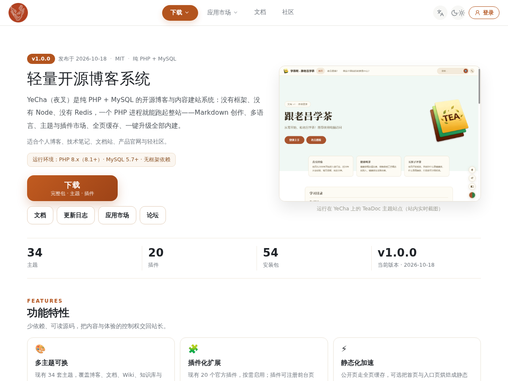

# yecha · YeCha 默认主题

> 版本 **1.1.0**（要求内核 ≥ 1.1.0）· 作者 YeCha · 许可 MIT

YeCha 的出厂默认主题。白底墨字 + 橙色强调（`--accent:#b3541e`），支持暗色、多语言、侧栏与文章目录。

## 1. 设计分层（三张样式表，顺序不可换）

| 顺序 | 文件 | 角色 |
|---|---|---|
| ① | `www.css` | 站点 www 形态的 Tailwind 产物：设计令牌（`--background/--foreground/--card/--border/--radius`）+ 原子类 |
| ② | `style.css` | 实例功能件：页头/页脚/列表/文章/评论/分页/搜索/归档/404 等组件样式 |
| ③ | `lq-align.css` | 桥接层：把功能件接到 ① 的令牌上，并补 `.dark` 令牌化配色 |

三层都通过 `View::asset('<file>')` 输出，自动带 `?v=<filemtime>`，改样式不会吃到浏览器旧缓存。

## 2. 目录结构

```
themes/yecha/
├─ theme.json              元数据 + 可配置项 schema（后台「主题」页读它）
├─ README.md               本文件
├─ screenshot.png          后台/市场预览图（1200×900）
├─ www.css / style.css / lq-align.css
├─ reader.js               文章页划线/笔记（post.php 里按需加载）
├─ feed.xsl / sitemap.xsl  RSS / sitemap 的浏览器端样式表
├─ logo.svg / logo-oni.png 主题默认 Logo（site.logo 未设时兜底）
├─ favicon.png             历史遗留（未引用，保留不删）
└─ views/
   ├─ layout.php           整页外壳：<head> → 页头 → 主栏/侧栏 → 页脚 → 内联脚本
   ├─ landing.php / landing-en.php  首页（中/英）→ 共同 require partials/landing-cms.php
   ├─ 404.php
   └─ partials/
      ├─ landing-cms.php   首页 CMS 版区块（取数全走 DB/目录，数字不写死）
      ├─ list.php / list-media.php   列表页（文字版 / 图文版，由 home.style 决定）
      ├─ post.php / page.php        文章页 / 独立页面
      ├─ comments.php                评论区（嵌套回复 + 段评，含 CSRF 与游客同源校验）
      ├─ search.php                  搜索结果页
      ├─ archives.php / meta-index.php / pages-list.php  归档 / 分类标签索引 / 页面列表
      └─ sidebar.php / sidebar-lang.php / sidebar-en.php / toc-side.php  侧栏与目录
```

## 3. 内核约定的模板（缺一即回落默认主题同名模板）

`404` · `landing` · `layout` · `partials/{archives,list,list-media,meta-index,page,pages-list,post,search,sidebar,sidebar-lang,toc-side}`
—— 本主题 13 个全部齐备（`core/View.php` 有实测清单）。

## 4. 可配置项（`theme.json` 的 `settings`，后台「主题 → 主题设置」保存即生效）

| key | 标签 | 类型 | 默认 | 说明 |
|---|---|---|---|---|
| `width` | 内容宽度 | number | 空 | 像素；留空 = 1152（CSS 变量 `--wide-w`） |
| `accent` | 强调色 | color | 空 | 留空 = `#b3541e`（CSS 变量 `--accent`，仅接受 `#hex`） |
| `per_page` | 每页条数 | number | 10 | 列表/首页每页条数 |
| `latest_n` | 侧栏最新文章数 | number | 8 | 侧栏「最新」条数 |
| `show_sidebar` | 显示侧栏 | select | 1 | `0` = 全站不渲染侧栏 |

站点级选项（非主题内）：`theme.default` 选主题、`site.logo`（页头 Logo 与 favicon）、`home.landing`（首页走 landing）、`home.style`（`text`/`img` 列表版式）。

## 5. 开发约定（改主题前先看这四条）

1. **所有输出走 `e()`**；确需输出 HTML 的（正文 `$html`、列表 `$sub`、`stats.head/foot`）在调用方已转义或来自管理员输入。
2. **静态资源一律 `View::asset('x.css')`**，不要写 `/themes/yecha/...` 死路径 —— 主题改名/换 slug 仍可用（本版已把页头 Logo/favicon 改成按 `theme.default` 推导）。
3. **站内链接**用内核函数（`ui_lp()` / `Poly::termUrl()` / `ui_login()` 等）拼，别拼绝对 `http(s)://`；多语言前缀由 `ui_lp()` 负责。
4. 中文/英文文案全部放 `lang/zh_CN.php`、`lang/en_US.php`，主题里只写 `__('key')`；本主题用到的 85 个 key 两套语言包都齐。

## 6. 预览



线上实例：<https://yecha.org/>
